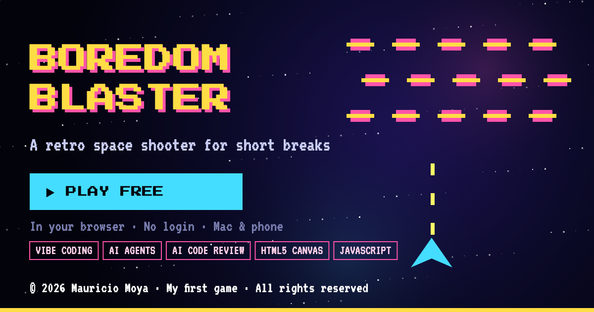

<p align="center">
  <a href="https://maumoya.github.io/boredom-blaster-play/"></a>
</p>

<p align="center">
  <a href="https://maumoya.github.io/boredom-blaster-play/"></a>
  <a href="https://github.com/maumoya/boredom-blaster-v2"></a>
</p>

<p align="center">
  
  
  
  
  <a href="LICENSE"></a>
  <br>
  <a href="https://github.com/maumoya/boredom-blaster-play/actions/workflows/test.yml"></a>
  <a href="https://github.com/maumoya/boredom-blaster-play/actions/workflows/codeql.yml"></a>
  <a href="https://scorecard.dev/viewer/?uri=github.com/maumoya/boredom-blaster-play"></a>
  <a href="https://www.bestpractices.dev/projects/16291"></a>
  <a href="https://github.com/maumoya/boredom-blaster-play/releases/latest"></a>
</p>

# Boredom Blaster v1

**The first version of Boredom Blaster: a retro arcade space shooter for short breaks.** One HTML file,
plays in the browser on a Mac or a phone. No login, no install.

This is the original game, kept as it was released. The newer, bigger game, with five worlds, bosses and global
scores, is [Boredom Blaster v2](https://github.com/maumoya/boredom-blaster-v2).

## The game

- **Arcade classic.** Rows of pixel saucers, one ship and a fire button.
- **Mac or phone.** Keyboard on the desktop, touch on the phone.
- **Tiny.** Everything (game, art and sound) lives in one 13.6 KB `index.html`, plus one web font.

## How it is built

Plain JavaScript and the HTML canvas in a single file, with no engine, framework or build step.
GitHub Pages serves `index.html` as it is. `og.png` and `og2.png` are the link-preview images.

## Results

Measured on 2026-11-03 against `main` at `7e6aec7` (release v1.0.0). Repeat it with the command below.

| Check | Result |
|---|---|
| Live page | HTTP **200**, **13,613 bytes**, loaded in 0.14 s |
| Live page is this repo's `main` | SHA-256 of the live page = SHA-256 of `index.html` (`391badb7…`) |
| External scripts | **0** (one Google Fonts stylesheet) |

```bash
curl -s https://maumoya.github.io/boredom-blaster-play/ | shasum -a 256 && curl -s https://raw.githubusercontent.com/maumoya/boredom-blaster-play/main/index.html | shasum -a 256
```

The two hashes match when the live game is exactly the code in this repository.

Smoke tests (`test/`, run with `node --test`) check that the page is complete, has no external scripts and that its
JavaScript parses.

## Contributing and security

See [CONTRIBUTING.md](CONTRIBUTING.md). Report vulnerabilities privately as described in [SECURITY.md](SECURITY.md).

## About the author

Designed and developed by **Mauricio Alonso Moya Tapia** ([@maumoya](https://github.com/maumoya)), his first game.
Released under the [MIT License](LICENSE). More of his work on [GitHub](https://github.com/maumoya); say hi on
[LinkedIn](https://www.linkedin.com/in/mba-mmoyat/).
